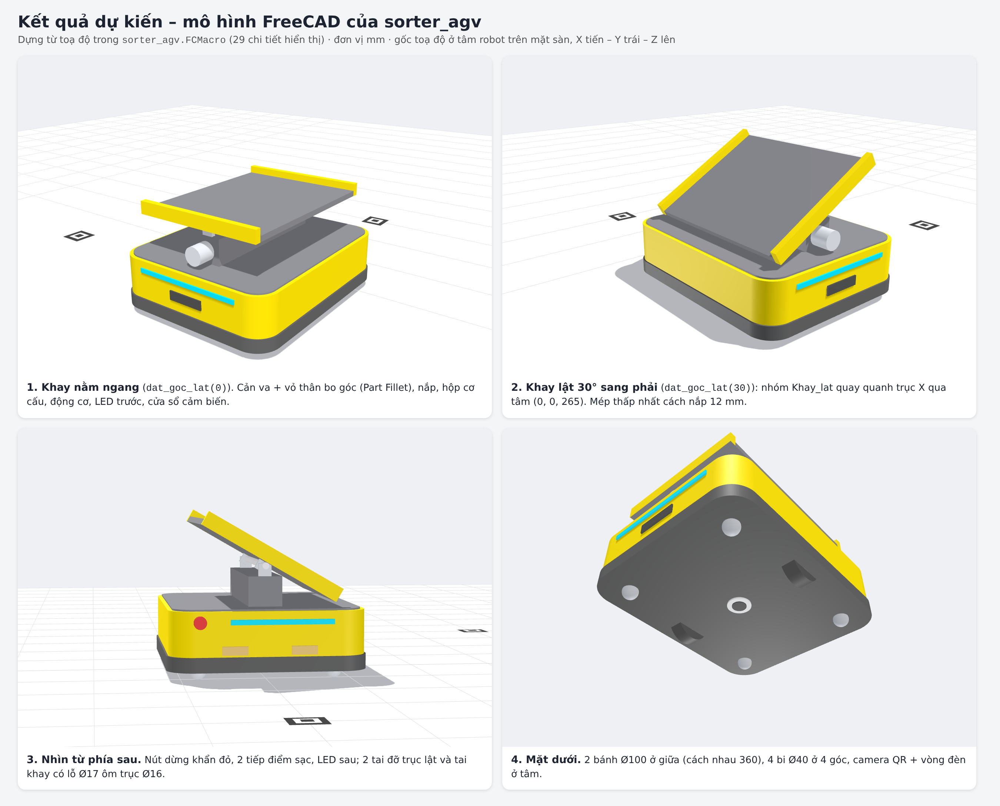

# Hướng dẫn vẽ robot chia chọn khay lật `sorter_agv` trong FreeCAD

Hướng dẫn này dựng lại robot `sorter_agv` từ một file FreeCAD trống. Kích thước lấy từ file URDF
`ros2_ws/src/amr_description/urdf/sorter_agv.urdf.xacro`, đổi sang **mm**. Toàn bộ robot chỉ dùng khối
cơ bản của workbench **Part** (hộp, trụ, cầu), bo góc (Fillet) và khoét lỗ (Cut), không cần vẽ sketch.



Dựng xong bạn sẽ có:

```
Robot
├── Than_xe    24 chi tiết đứng yên (thân, bánh, bi, camera, cơ cấu, phụ kiện)
└── Khay_lat    5 chi tiết lật được ±30° quanh trục X
```

> **Muốn có ngay mô hình?** Mở file `sorter_agv.FCMacro` trong thư mục này rồi chạy (xem
> [Phụ lục A](#phụ-lục-a--chạy-macro-dựng-tự-động)). Macro làm đúng các bước dưới đây, rất tiện để đối chiếu
> khi bạn tự vẽ.

---

## Bước 0 – Chuẩn bị

1. Mở FreeCAD. Hướng dẫn viết cho bản **1.0**, bản 0.21 cũng làm được.
2. Đặt đơn vị mm: **Edit → Preferences → General → Units**, chọn *Unit system* =
   **Standard (mm, kg, s, °)**, *Number of decimals* = 2 → **OK**.
3. Tạo file mới: **File → New** (`Ctrl+N`), rồi lưu ngay: **File → Save** (`Ctrl+S`) với tên
   `sorter_agv.FCStd`.
4. Chuyển sang workbench **Part**: bấm danh sách workbench trên thanh công cụ, hoặc
   **View → Workbench → Part**.
5. Mở 2 bảng: **View → Panels → Tree view** và **Property view**. Mọi thông số sẽ nhập ở tab **Data**
   của Property view.

### Quy ước toạ độ (rất quan trọng)

| Trục | Hướng trên robot |
|---|---|
| **X** | về **phía trước** robot (phía có LED trước và cửa sổ cảm biến) |
| **Y** | sang **trái** robot |
| **Z** | hướng **lên** |

Gốc (0, 0, 0) nằm ở **tâm robot trên mặt sàn**.

Ba loại khối dùng `Placement → Position` theo ba cách khác nhau:

| Khối | Nút trên thanh Part | `Position` là điểm nào | Mặc định nằm theo |
|---|---|---|---|
| Hộp (*Cube*) | Part_Box | **góc nhỏ nhất** (x, y, z nhỏ nhất) của hộp | Length theo X, Width theo Y, Height theo Z |
| Trụ (*Cylinder*) | Part_Cylinder | **tâm mặt đáy** | trục dọc +Z |
| Cầu (*Sphere*) | Part_Sphere | **tâm** cầu | – |

Để xoay trụ sang trục khác, đặt **Axis** và **Angle** trong `Placement`:

| Muốn trụ nằm dọc | Axis (x, y, z) | Angle |
|---|---|---|
| +Z (đứng) | để mặc định | 0° |
| **+X** (dọc thân robot) | (0, **1**, 0) | **90°** |
| **+Y** (ngang thân robot) | (**1**, 0, 0) | **−90°** |

### Cách làm chung cho mỗi chi tiết

1. Bấm nút tạo khối (Cube / Cylinder / Sphere).
2. Chọn đối tượng vừa tạo trong Tree view, bấm **F2** để đổi tên theo bảng.
3. Ở tab **Data**, nhập kích thước (Length/Width/Height, hoặc Radius/Height), rồi mở **Placement** để nhập
   **Position** x, y, z (và **Axis**, **Angle** nếu cần).
4. Tô màu: chọn đối tượng → `Ctrl+D` (hoặc chuột phải → **Appearance...**) → bấm ô **Shape color**
   → nhập mã màu (HTML) theo bảng:

| Tên màu | Mã | Dùng cho |
|---|---|---|
| Vàng | `#FFC700` | vỏ thân, gờ khay |
| Cao su | `#1F1F1F` | cản va, lốp |
| Xám tối | `#404045` | nắp, hộp cơ cấu, mặt khay |
| Nhôm | `#B8BDC7` | moay-ơ, bi, động cơ, tai đỡ |
| Inox | `#E0E0E6` | trục lật |
| Đen | `#141414` | camera, cửa sổ cảm biến |
| Trắng | `#EBEBEB` | vòng đèn camera |
| Xanh LED | `#00CCFF` | dải LED |
| Đỏ | `#D90D0D` | nút dừng khẩn |
| Đồng | `#D99433` | tiếp điểm sạc |

Bấm `Ctrl+S` sau mỗi bước.

---

## Bước 1 – Cản va cao su (đáy thân, z 25 → 60)

Robot cách sàn 25 mm. Cản va là khối hộp bo góc ở phần dưới cùng của thân.

1. **Cube**, đổi tên `Can_va_hop`. Đặt Length **568**, Width **468**, Height **35**, Position
   (**−284**, **−234**, **25**).
2. Bo 4 cạnh đứng: menu **Part → Fillet...**
   - *Shape*: chọn `Can_va_hop`.
   - *Fillet type*: **Constant Radius**, *Radius* = **64 mm**.
   - Tick 4 **cạnh đứng** (song song trục Z), thường là `Edge1`, `Edge3`, `Edge5`, `Edge7`. Chắc ăn nhất là
     bấm thẳng vào 4 cạnh dọc ở 4 góc hộp trong khung 3D.
   - **OK**. FreeCAD tạo đối tượng `Fillet` và tự ẩn hộp gốc.
3. Đổi tên `Fillet` thành `Can_va`, tô màu **Cao su**.

## Bước 2 – Vỏ thân màu vàng (z 60 → 165)

1. **Cube** `Vo_than_hop`: Length **560**, Width **460**, Height **105**, Position (**−280**, **−230**, **60**).
2. **Part → Fillet...** bo 4 cạnh đứng, *Radius* = **60**. Đổi tên đối tượng Fillet vừa tạo thành `Vo_than`,
   màu **Vàng**.

> Vỏ hẹp hơn cản va 4 mm mỗi bên nên cản va lộ ra thành viền đen quanh chân robot.

## Bước 3 – Nắp trên (z 165 → 169)

1. **Cube** `Nap_hop`: Length **540**, Width **440**, Height **4**, Position (**−270**, **−220**, **165**).
2. Fillet 4 cạnh đứng, *Radius* = **50**. Đổi tên `Nap`, màu **Xám tối**.

Bấm phím **0** để xem dạng isometric: bạn sẽ thấy một khối vàng bo góc có đế đen và nắp xám.

## Bước 4 – Hai bánh chủ động Ø100 × 35, cách nhau 360

Bánh nằm dưới gầm, quay quanh trục Y. Tâm bánh ở (0, ±180, 50).

| Tên | Loại | Kích thước | Position (x, y, z) | Axis | Angle | Màu |
|---|---|---|---|---|---|---|
| `Banh_trai` | Cylinder | Radius 50, Height 35 | (0, **162.5**, 50) | (1, 0, 0) | −90° | Cao su |
| `Banh_phai` | Cylinder | Radius 50, Height 35 | (0, **−197.5**, 50) | (1, 0, 0) | −90° | Cao su |
| `May_banh_trai` | Cylinder | Radius 25, Height 37 | (0, **161.5**, 50) | (1, 0, 0) | −90° | Nhôm |
| `May_banh_phai` | Cylinder | Radius 25, Height 37 | (0, **−198.5**, 50) | (1, 0, 0) | −90° | Nhôm |

Trụ quay `Axis (1,0,0)`, `Angle −90°` sẽ kéo dài về phía **+Y** tính từ Position. Vì vậy bánh trái chiếm
y = 162.5 → 197.5, bánh phải chiếm y = −197.5 → −162.5. Moay-ơ dài hơn lốp 2 mm để lộ ra hai bên.

Bấm phím **5** (Bottom) để nhìn từ dưới lên kiểm tra.

## Bước 5 – Bốn bi tự lựa Ø40 ở 4 góc

| Tên | Loại | Radius | Position (x, y, z) | Màu |
|---|---|---|---|---|
| `Bi_truoc_trai` | Sphere | 20 | (210, 160, 21) | Nhôm |
| `Bi_truoc_phai` | Sphere | 20 | (210, −160, 21) | Nhôm |
| `Bi_sau_trai` | Sphere | 20 | (−210, 160, 21) | Nhôm |
| `Bi_sau_phai` | Sphere | 20 | (−210, −160, 21) | Nhôm |

Tâm bi ở z = 21, nên đáy bi cách sàn 1 mm. Như vậy toàn bộ tải dồn lên 2 bánh chủ động.

> Mẹo: làm xong một quả, chọn nó rồi `Ctrl+C`, `Ctrl+V`, rồi chỉ cần sửa tên và Position.

## Bước 6 – Camera đọc mã QR dưới đáy

| Tên | Loại | Kích thước | Position (x, y, z) | Màu |
|---|---|---|---|---|
| `Camera_QR` | Cylinder | Radius 18, Height 6 | (0, 0, 19) | Đen |
| `Vong_den_QR` | Cylinder | Radius 30, Height 4 | (0, 0, 21) | Trắng |

Cả hai trụ đứng (không cần xoay). Ống kính thò thấp hơn vòng đèn 2 mm nên nhìn từ dưới thấy rõ.

## Bước 7 – Hộp cơ cấu lật và động cơ

| Tên | Loại | Kích thước | Position (x, y, z) | Axis / Angle | Màu |
|---|---|---|---|---|---|
| `Hop_co_cau` | Cube | L 400, W 80, H 71 | (−200, −40, 169) | – | Xám tối |
| `Dong_co` | Cylinder | Radius 25, Height 50 | (200, 0, 202.5) | (0, 1, 0) / **90°** | Nhôm |

Hộp đặt trên nắp, chiếm z 169 → 240. Động cơ nằm dọc trục X, gắn vào đầu trước của hộp (x 200 → 250).

## Bước 8 – Hai tai đỡ và trục lật

Trục lật nằm dọc thân robot (trục X) ở độ cao **z = 265**, cao hơn nắp 100 mm. Độ cao này đủ để khay lật 30°
mà không chạm thân.

| Tên | Loại | Kích thước | Position (x, y, z) | Axis / Angle | Màu |
|---|---|---|---|---|---|
| `Tai_do_truoc` | Cube | L 12, W 30, H 35 | (184, −15, 235) | – | Nhôm |
| `Tai_do_sau` | Cube | L 12, W 30, H 35 | (−196, −15, 235) | – | Nhôm |
| `Truc_lat` | Cylinder | Radius **8**, Height **420** | (−210, 0, 265) | (0, 1, 0) / **90°** | Inox |

Trục chạy từ x = −210 đến 210 và xuyên qua cả hai tai đỡ.

## Bước 9 – Phụ kiện: LED, cảm biến, nút dừng khẩn, tiếp điểm sạc

Các chi tiết dán lên mặt trước (x = +280) và mặt sau (x = −280) của vỏ thân.

| Tên | Loại | Kích thước | Position (x, y, z) | Axis / Angle | Màu |
|---|---|---|---|---|---|
| `LED_truoc` | Cube | L 4, W 300, H 12 | (280, −150, 134) | – | Xanh LED |
| `Cua_so_cam_bien` | Cube | L 4, W 100, H 25 | (280, −50, 87.5) | – | Đen |
| `LED_sau` | Cube | L 4, W 240, H 12 | (−284, −150, 134) | – | Xanh LED |
| `Nut_dung_khan` | Cylinder | Radius 15, Height 12 | (−292, 160, 140) | (0, 1, 0) / 90° | Đỏ |
| `Tiep_diem_sac_trai` | Cube | L 6, W 60, H 20 | (−286, 50, 65) | – | Đồng |
| `Tiep_diem_sac_phai` | Cube | L 6, W 60, H 20 | (−286, −110, 65) | – | Đồng |

Bấm phím **3** (Right, nhìn từ +X) để thấy mặt trước robot, phím **4** (Rear) để thấy mặt sau.

## Bước 10 – Khay lật

Khay gồm mặt khay, 2 gờ chặn ở đầu và cuối (hai cạnh bên để hở cho hàng trượt xuống) và 2 tai khay có lỗ
ôm trục lật.

### 10a. Mặt khay và gờ chặn

| Tên | Loại | Kích thước | Position (x, y, z) | Màu |
|---|---|---|---|---|
| `Mat_khay` | Cube | L **480**, W **360**, H 15 | (−240, −180, 273) | Xám tối |
| `Go_chan_truoc` | Cube | L 17, W 362, H 35 | (224, −181, 273) | Vàng |
| `Go_chan_sau` | Cube | L 17, W 362, H 35 | (−241, −181, 273) | Vàng |

Mặt khay cao hơn trục 8 mm (z 273 → 288). Gờ cao hơn mặt khay 20 mm.

### 10b. Tai khay có lỗ Ø17 (khoét bằng Boolean Cut)

1. Tạo 2 khối tai:

   | Tên | Loại | Kích thước | Position (x, y, z) |
   |---|---|---|---|
   | `Tai_khay_truoc_khoi` | Cube | L 12, W 30, H 24 | (154, −15, 249) |
   | `Tai_khay_sau_khoi` | Cube | L 12, W 30, H 24 | (−166, −15, 249) |

2. Tạo 2 trụ làm "mũi khoan", lớn hơn trục 0.5 mm để có khe hở:

   | Tên | Loại | Kích thước | Position (x, y, z) | Axis / Angle |
   |---|---|---|---|---|
   | `Lo_truoc` | Cylinder | Radius **8.5**, Height 40 | (140, 0, 265) | (0, 1, 0) / 90° |
   | `Lo_sau` | Cylinder | Radius **8.5**, Height 40 | (−180, 0, 265) | (0, 1, 0) / 90° |

3. Khoét: trong Tree view bấm `Tai_khay_truoc_khoi`, giữ **Ctrl** bấm thêm `Lo_truoc` (**chọn khối bị khoét
   trước, mũi khoan sau**) → menu **Part → Boolean → Cut**. Đổi tên kết quả thành `Tai_khay_truoc`, màu
   **Nhôm**.
4. Làm tương tự với `Tai_khay_sau_khoi` và `Lo_sau`, đặt tên `Tai_khay_sau`.

## Bước 11 – Gom nhóm

1. Bấm nút **Create part** (biểu tượng khối vàng trên thanh *Structure*) **3 lần**, đổi tên các nhóm thành
   `Robot`, `Than_xe`, `Khay_lat`.
2. Trong Tree view, kéo-thả `Than_xe` và `Khay_lat` vào trong `Robot`.
3. Kéo-thả vào **`Khay_lat`**: `Mat_khay`, `Go_chan_truoc`, `Go_chan_sau`, `Tai_khay_truoc`, `Tai_khay_sau`
   (khối gốc và mũi khoan của bước 10b thường tự đi theo kết quả Cut; nếu không, kéo cả chúng vào).
4. Kéo-thả **mọi chi tiết còn lại** vào **`Than_xe`**.

Bây giờ chỉ cần xoay nhóm `Khay_lat` là toàn bộ khay lật theo.

## Bước 12 – Lật khay để xem cơ cấu

1. Chọn `Khay_lat` trong Tree view → menu **Edit → Placement...**
2. Trong bảng Placement:
   - **Translation**: để (0, 0, 0).
   - **Center**: nhập (**0**, **0**, **265**). Đây là tâm trục lật, phải nhập đúng, nếu không khay sẽ quay
     quanh gốc toạ độ và bay khỏi robot.
   - **Rotation** (kiểu *Rotation axis with angle*): Axis = **X** (1, 0, 0), Angle = **30°** → **Apply**.
3. Kết quả:

   | Angle | Khay |
   |---|---|
   | **+30°** | cạnh trái nâng lên → hàng đổ sang **phải** |
   | **−30°** | hàng đổ sang **trái** |
   | **0°** | nằm ngang (trạng thái chở hàng) |

4. Bấm phím **4** (Rear) để nhìn thẳng từ sau và kiểm tra khe hở. Khi lật 30°, mép thấp nhất của khay ở
   z ≈ 181, còn cách nắp (z 169) khoảng **12 mm**. Tai khay còn cách đỉnh hộp cơ cấu khoảng **3.6 mm**.
   Dùng công cụ **Measure** để đo kiểm.
5. Đưa Angle về **0°** trước khi lưu (`Ctrl+S`).

## Bước 13 – Kiểm tra lại

So với ảnh `ket_qua_du_kien.png` ở đầu hướng dẫn và bảng kích thước tổng:

| Hạng mục | Giá trị |
|---|---|
| Kích thước bao (khay nằm ngang) | dài ≈ 576 (từ nút dừng −292 đến LED +284), rộng 468, cao 308 mm |
| Khoảng sáng gầm | 25 mm |
| Mặt khay | 480 × 360 mm, mặt trên z = 288 |
| Trục lật | Ø16, z = 265, dọc trục X |
| Góc lật | ±30° |
| Bánh chủ động | Ø100 × 35, tâm (0, ±180, 50) |
| Bi tự lựa | Ø40, tâm (±210, ±160, 21) |

Nếu một chi tiết lệch chỗ, gần như luôn do nhập Position của **hộp** như thể là tâm. Hãy nhớ: Position của
hộp là **góc nhỏ nhất**.

## Bước 14 (tuỳ chọn) – Xuất file và đưa vào ROS 2 / RViz2

**Xuất STEP** để gửi cho người dùng CAD khác: chọn `Robot` → **File → Export...** → kiểu
**STEP with colors (*.step *.stp)**.

**Xuất STL làm mesh cho URDF** (đặt khay về 0° trước khi xuất):

1. Trong `Than_xe`, chọn mọi chi tiết **trừ 2 bánh và 2 moay-ơ** (URDF đã có link bánh riêng để bánh quay)
   → **File → Export...** → **STL Mesh (*.stl)** → `sorter_base.stl`.
2. Chọn `Khay_lat` → xuất `sorter_tray.stl`.
3. Chép 2 file vào `ros2_ws/src/amr_description/meshes/`, thêm `meshes` vào dòng
   `install(DIRECTORY ...)` trong `CMakeLists.txt` của `amr_description`.
4. Trong `sorter_agv.urdf.xacro`, có thể thay các visual hình khối cơ bản bằng mesh. FreeCAD dùng **mm** và
   gốc ở mặt sàn, còn URDF dùng **m** và đặt gốc các link khác chỗ, nên cần `scale` và dời `origin`:

   ```xml
   <!-- trong <link name="base_link">: base_link cao 0.095 m so với sàn -->
   <visual>
     <origin xyz="0 0 -0.095" rpy="0 0 0"/>
     <geometry>
       <mesh filename="package://amr_description/meshes/sorter_base.stl" scale="0.001 0.001 0.001"/>
     </geometry>
     <material name="sorter_yellow"/>
   </visual>

   <!-- trong <link name="tilt_tray_link">: gốc link nằm ở tâm trục lật, cao 0.265 m -->
   <visual>
     <origin xyz="0 0 -0.265" rpy="0 0 0"/>
     <geometry>
       <mesh filename="package://amr_description/meshes/sorter_tray.stl" scale="0.001 0.001 0.001"/>
     </geometry>
     <material name="amr_dark"/>
   </visual>
   ```

   STL chỉ mang một màu cho cả file. Muốn giữ màu từng chi tiết thì xuất từng nhóm màu ra file riêng, hoặc
   dùng định dạng `.dae` (Collada).
5. Build lại rồi xem trên RViz2:

   ```bash
   ros2 launch amr_description display.launch.py model:=sorter_agv
   ```

---

## Phụ lục A – Chạy macro dựng tự động

1. **File → Open...** → chọn `cad/sorter_agv/sorter_agv.FCMacro`. File mở ra trong trình soạn macro.
2. Bấm nút **Execute macro** (tam giác xanh trên thanh Macro) hoặc `Ctrl+F6`.
3. Macro tạo tài liệu mới `sorter_agv` gồm 39 đối tượng: 29 chi tiết hiển thị, 7 khối gốc / mũi khoan bị
   ẩn và 3 nhóm. Các chi tiết đã được tô màu và đặt góc nhìn isometric.
4. Lật khay bằng **View → Panels → Python console**:

   ```python
   dat_goc_lat(30)    # đổ hàng sang phải
   dat_goc_lat(-30)   # đổ hàng sang trái
   dat_goc_lat(0)     # nằm ngang
   ```

   Nếu console báo `NameError`, hãy dùng cách thủ công ở Bước 12.
5. Muốn đổi kích thước: sửa trực tiếp các con số trong macro rồi chạy lại.

> Macro đã được chạy thử trên một bản giả lập API FreeCAD để kiểm tra lỗi Python, toạ độ từng chi tiết
> (khớp với URDF) và khe hở khi lật khay. Macro **chưa được chạy trong FreeCAD thật**. Nếu gặp lỗi, hãy chép
> nguyên văn thông báo trong **Report view** (View → Panels → Report view) để sửa.

## Phụ lục B – Lỗi thường gặp

| Hiện tượng | Nguyên nhân / cách sửa |
|---|---|
| Chi tiết nằm lệch nửa kích thước | Nhập Position của **hộp** như tâm. Position của Cube là **góc nhỏ nhất**. |
| Trụ dựng đứng thay vì nằm ngang | Thiếu Axis/Angle. Dọc X: Axis (0,1,0), 90°. Dọc Y: Axis (1,0,0), −90°. |
| Bánh xe thò sai phía | Với Axis (1,0,0), −90°, trụ kéo dài về **+Y** từ Position. Bánh phải phải đặt y = −197.5, không phải −162.5. |
| Fillet báo lỗi / không tạo được | Chọn nhầm cạnh ngang, hoặc bán kính ≥ nửa chiều nhỏ nhất của hộp. Chỉ chọn 4 cạnh **đứng**. |
| Sau Fillet/Cut, khối gốc "biến mất" | Bình thường: FreeCAD tự ẩn khối gốc. Đừng xoá nó, Fillet/Cut cần khối gốc. |
| Khay lật bay khỏi robot | Quên nhập **Center (0, 0, 265)** trong bảng Placement của `Khay_lat`. |
| Kéo chi tiết vào nhóm bị cảnh báo "out of scope" | Kéo cả khối gốc / mũi khoan đi kèm vào cùng nhóm với kết quả Fillet/Cut. |
| Màu không đổi | Đang chọn khối gốc bị ẩn thay vì kết quả `Fillet` / `Cut`. Chọn đúng đối tượng hiển thị rồi `Ctrl+D`. |
